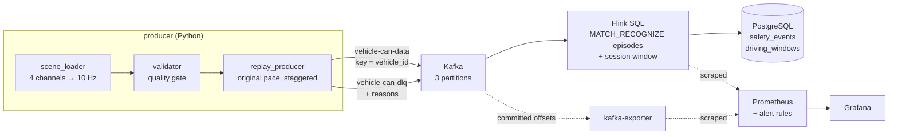
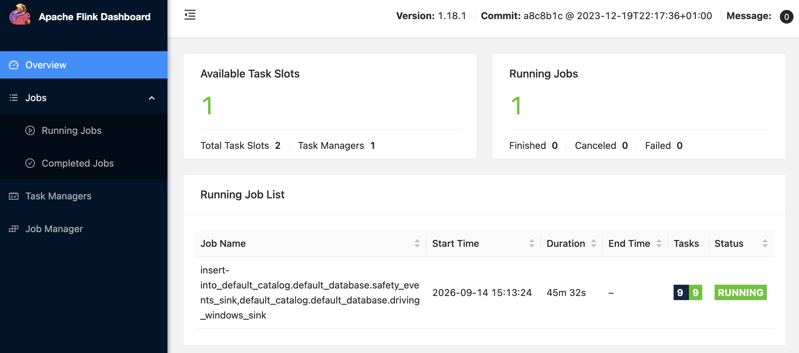
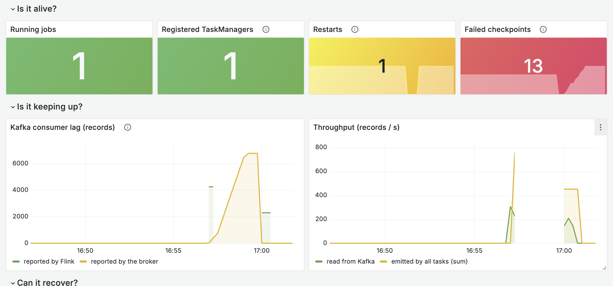
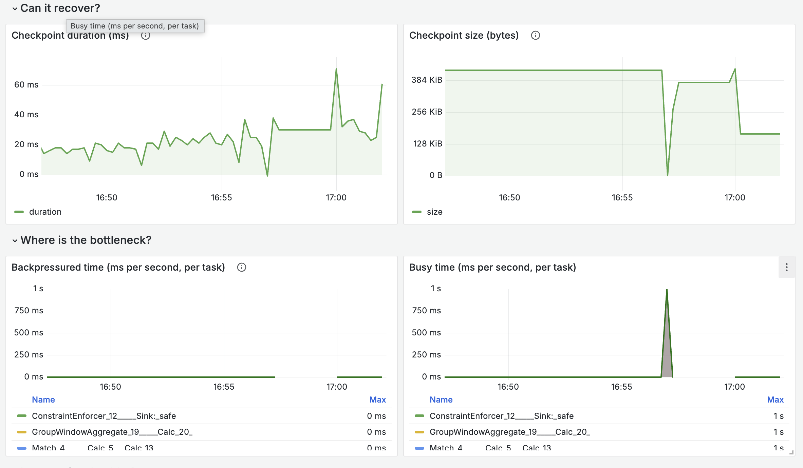
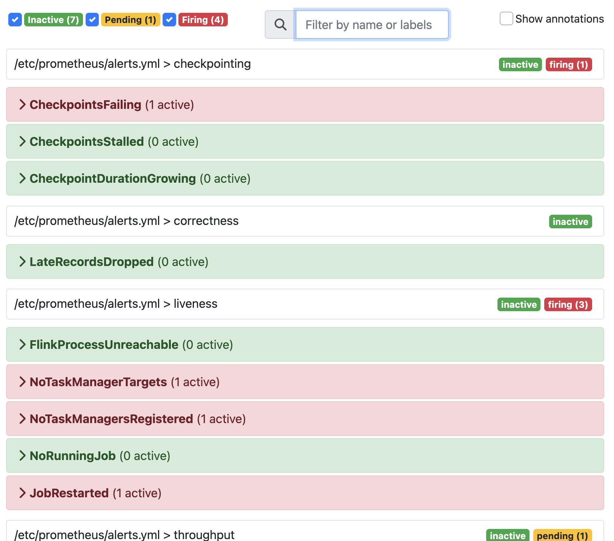
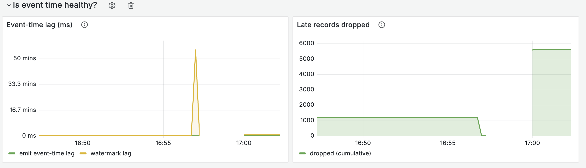

# nuScenes Driving Safety Pipeline

Real-time driving-safety analysis over **real autonomous-vehicle CAN bus data** — 979 driving
scenes recorded by Motional's Renault Zoe AV fleet ([nuScenes CAN bus expansion](https://www.nuscenes.org/nuscenes#canbus)).

The four CAN channels that carry driving dynamics — sampled anywhere between **2 Hz and 950 Hz** —
are unified onto a common 10 Hz stream, validated, replayed into Kafka at their original pace, and
analysed by Flink SQL, which recognises each harsh manoeuvre as a single episode and groups
manoeuvres that cluster in time — with results landing in PostgreSQL.

> 실제 자율주행 차량에서 수집한 nuScenes CAN 버스 데이터 기반 실시간 주행 안전성 분석 파이프라인.
> 2Hz~950Hz로 주파수가 제각각인 CAN 채널을 10Hz로 통합·검증한 뒤 Kafka로 재생하고, Flink SQL로 급제동·
> 급선회·급가속을 '사건' 단위로 탐지하고, 짧은 시간에 몰린 사건들을 묶어 난폭운전 패턴까지 집계합니다.

| Scenes | Records validated | Quarantined to DLQ | Sample rates unified | Manoeuvres detected |
|:--:|:--:|:--:|:--:|:--:|
| **979** | **191,089** | **207** (0.108%) | **2 Hz–950 Hz → 10 Hz** | **104** across 92 scenes |

## What the real data broke

Synthetic data never disagrees with itself. Real sensors drift apart, drop out, and arrive at
different rates — and every problem below surfaced only because the input is a recording of an
actual vehicle on a public road. Each was traced to a root cause and fixed:

| Symptom | Evidence | Root cause | Fix |
|---|---|---|---|
| **15 records flagged as sensor faults** | every one of the 15 occurred while accelerating or braking | the 2 Hz dashboard reading is forward-filled and can be 500 ms stale, while wheel rpm is current — during a speed change the two disagree *legitimately* | tolerance now includes the physics: `speed × 35% + abs(accel) × 0.5 s` → **15 false positives → 0**, no true positive lost |
| **A defect in the dataset itself** | 199 records from one scene | `scene-0419` ships with an **empty** `vehicle_monitor` channel | loader returns null instead of crashing; validator quarantines the scene to the DLQ with reasons |
| **Windowed results never appeared** while event rules were perfect | watermark frozen at `15:14:12`; the window needed `15:14:30` | replay started all scenes at the same instant, so the stream spanned **20 s — shorter than the 30 s window**, which therefore could never be passed | staggered scene starts (what a real fleet looks like) widened the stream to **~100 s**; the stuck window was released too |
| **Flink job died at startup** | `0` of `2` INSERT statements recognised | statements were classified by their first keyword, but a threshold-documenting comment precedes every INSERT | leading comment lines are skipped before classification — documentation can no longer break execution |
| **Event counts were inflated up to 10×** | one hard brake reported as 2 rows, one corner as 3 — and that corner was the only thing the 30 s window ever flagged as aggressive driving | a manoeuvre lasts about a second, i.e. ten 100 ms bins, and every bin that crossed the threshold became its own event; counting bins is not counting manoeuvres | `MATCH_RECOGNIZE` with two thresholds collapses each manoeuvre into **one** row — the aggressive-driving flag now counts manoeuvres, and its single previous hit turned out to be a **false positive** |
| **A rule that detected nothing real** | `PEDAL_MISUSE` reported 30 hits; the raw data contains **6**, all at 0.00 km/h | `throttle` is a raw CAN value (0–496), not the percentage the rule's comment claimed, and the rule had no speed guard — the 6 hits are a stationary car being eased off the brake | replaced with `HARSH_ACCEL`, completing the standard harsh-braking / cornering / acceleration triad |

The parsing bug also existed in this project's [predecessor](#prior-version) and was backported there.

## Architecture



The metrics path is dotted because nothing in it carries data — and `kafka-exporter` hangs off
Kafka rather than off Flink on purpose, so that lag is still observable when Flink is the thing
that has failed.

## The data

Each scene is roughly 20 seconds of driving, recorded as one JSON file per channel. Every record
carries a `utime` microsecond timestamp, so the channels can be re-aligned onto a shared clock.

| Channel | Rate | What it is | Fields used |
|---|---|---|---|
| `vehicle_monitor` | 2 Hz | dashboard summary | `vehicle_speed`, `yaw_rate`, `brake`, `throttle` |
| `ms_imu` | 100 Hz | inertial measurement | `linear_accel` (longitudinal / lateral) |
| `zoe_veh_info` | 100 Hz | vehicle CAN detail | four wheel speeds, `steer_corrected` |
| `zoesensors` | ~950 Hz | raw pedal sensors | `brake_sensor`, `throttle_sensor` |

**Resampling to 10 Hz.** Slow channels are *forward-filled* (a 2 Hz dashboard value stays valid
until the next one arrives); fast channels are *aggregated per 100 ms bin*. Averaging alone would
erase the very events we are looking for — a single −8 m/s² spike inside a bin disappears into the
mean — so each bin also keeps its extremes (`accel_lon_min`, `accel_lat_max`). Downsampling is
lossy by definition; the originals stay on disk, so anything faster than 100 ms remains
reprocessable rather than lost.

## Data-quality gate

The validator rejects only what is **physically impossible** — a speed no Renault Zoe can reach,
an acceleration beyond tyre-friction limits — and lets through everything that is merely
*dangerous*, because deciding whether hard braking is real is the detector's job, not the
validator's. Rejected records are not dropped: they go to a dead-letter topic with their reasons
attached, so nothing disappears silently and a rejection can still be read back:

```bash
docker compose exec kafka kafka-console-consumer \
  --bootstrap-server kafka:9092 --topic vehicle-can-dlq --from-beginning --max-messages 5
```

```json
{"record": {"vehicle_id": "scene-0419", "ts_us": 1538034043820333, "speed_kmh": null,
            "accel_lon_min": -1.1546, "wheel_rpm_mean": 233.02, "brake_sensor": 0.2915, ...},
 "reasons": ["missing:speed_kmh"]}
```

The surrounding fields are why the quarantine is legible: the accelerometer, the wheels and the
pedals all read normally, so this is a real drive with one channel missing rather than a corrupt
record. Grouping the topic by vehicle makes the same point in aggregate — replaying `scene-0419`
alongside two healthy scenes puts 199 of 200 rejections on that one vehicle, which is the shape a
sensor fault takes. The DLQ rate is not yet wired to an alert of its own — see
[Watching it](#watching-it) for what is; what exists here is the record and the reason, kept where
they can be queried.

| Check | Rule |
|---|---|
| Range | speed outside 0–200 km/h; \|accel\| > 15 m/s² (1.5 G); \|yaw rate\| > 120 °/s |
| Completeness | required fields missing or null |
| Cross-channel | dashboard speed vs. mean wheel rpm disagree beyond tolerance |
| Ordering | event time moving backwards |

**Full-dataset sweep:** 191,089 records clean, 207 to DLQ (**0.108%**). Of those, 199 come from a
single scene — `scene-0419`, whose `vehicle_monitor` channel is **empty in the dataset itself**.
The remaining 8 are isolated cross-channel mismatches kept in the DLQ for inspection.

The cross-channel check needed one correction that is worth recording. It initially flagged 15
records as sensor faults; all 15 turned out to be *accelerating or braking*. The dashboard value is
2 Hz and forward-filled, so it can be up to 500 ms stale while the wheel reading is current —
during a speed change the two channels disagree legitimately. The tolerance now includes that
physics: `speed × 35% + |accel| × 0.5 s`. All 15 false positives disappeared, and no true positive
was lost.

## Detection rules

Entry thresholds are quoted from vehicle dynamics rather than invented, then checked against all
979 scenes so that all three sit at the **same selectivity** — the top ~0.1% of bins above
10 km/h — instead of each being arbitrarily strict or loose.

| Rule | Entry threshold | Rationale | Manoeuvres |
|---|---|---|---|
| `HARSH_BRAKE` | `accel_lon_min < −4.0 m/s²` | comfortable braking sits near 2.5 m/s²; 4 m/s² (0.4 G) is a genuine hard stop — top 0.12% | **15** |
| `SHARP_TURN` | `abs(accel_lat_max) > 3.0 m/s²` | lateral acceleration already encodes speed × curvature, so it beats steering angle alone — top 0.10% | **47** |
| `HARSH_ACCEL` | `accel_lon_max > 2.5 m/s²` | low end of the industry harsh-acceleration range (2.5–3.5) and top 0.10% here | **42** |
| `AGGRESSIVE_DRIVING` | ≥ 2 manoeuvres within 10 s of each other | one hard brake may be evasive; a second one seconds later is a pattern | 10 scenes |

Every rule is guarded by `speed > 10 km/h`, which excludes parking-lot manoeuvres where large
steering angles and small decelerations are normal.

**Manoeuvres, not threshold crossings.** A hard brake lasts about a second — ten 100 ms bins — and
the signal wobbles across the threshold while it does, so counting bins counted one brake up to ten
times. Each rule is therefore evaluated as an *episode*: `MATCH_RECOGNIZE` enters on the threshold
above, holds while the signal stays past 75% of it, and requires at least two bins, since over half
of the single-bin accelerations were momentary spikes — road impact rather than driving. Each
episode is stored once, with its duration and peak.

Grouping them is a **session** rather than a fixed window. The question is whether two manoeuvres
happened close together, but a tumbling window asks whether they fell in the same fixed box — and
those differ: scene-0056's two manoeuvres are 12 seconds apart, yet a boundary landed between them
and the rule missed a case it exists to catch. A session asks the intended question and reports the
burst's own extent.

The 10-second gap comes from how manoeuvres actually cluster: of the 11 pairs sharing a scene,
eight fall within 2 seconds of each other (median 1.7 s) — a brake followed by a swerve rather than
two unrelated events. Any gap between 5 and 10 seconds selects the same 10 scenes, so the choice
sits on a plateau rather than a knife edge, and beyond 15 seconds it stops constraining anything,
since a scene is only 20 seconds long. Matching the window to the 20-second scene length would have
been the wrong instinct: that number describes how the dataset was cut, not how driving behaves.

One limitation is worth stating: an episode still in progress when a vehicle's stream ends is never
emitted, because the pattern needs a row that breaks it to close. That is 3 of the 104 manoeuvres
here (2.9%), and those are truncated in the recording as well — the scene ends mid-corner, so their
duration and peak are unknown anyway. A continuously flowing stream does not have this boundary.

The two-bin floor is a definition rather than a noise filter, and worth stating precisely because
the obvious explanation turned out to be wrong. Single-bin crossings looked like road impact, but
checking the vertical axis, the throttle and the subsequent speed shows otherwise: 96% of them have
the accelerator applied, so they are genuine — merely weak, gaining a third of the speed a longer
episode does and showing no speed gain at all in half of the cases. Commercial telematics likewise
require a harsh event to persist, generally for longer than 200 ms.

Median episode: 0.8 s for braking (peak 4.34 m/s²), 0.4 s for cornering (3.31), 0.2 s for
acceleration (2.78).

## Verification

Detection output is checked against expectations computed independently of the pipeline: the same
rule logic is applied directly to the scene files, and the counts are compared with what the
running cluster wrote to PostgreSQL.

Running 8 scenes (1,551 records, staggered starts) through the cluster produced exactly the seven
manoeuvres computed offline for those scenes, each with the same duration, bin count and peak, and
the one truncated episode correctly absent. Two bursts were flagged: `scene-0203`, which
accelerates hard and then brakes hard 4.7 seconds later, and `scene-0574`, which takes two sharp
turns 1.3 seconds apart. `scene-0056` was correctly *not* flagged — its two manoeuvres are 12
seconds apart, beyond the gap that defines a burst.



One Flink job, nine tasks, both sinks fed from a single read of the topic — the two INSERTs are
submitted together as one StatementSet rather than as two jobs scanning Kafka twice.

What the cluster wrote, verbatim:

**`safety_events`** — one row per manoeuvre, with the extent and peak of each

| vehicle_id | event_type | duration_s | peak | bins |
|---|---|--:|--:|--:|
| scene-0056 | HARSH_ACCEL | 0.9 | 3.65 | 9 |
| scene-0056 | SHARP_TURN | 0.4 | 3.05 | 4 |
| scene-0203 | HARSH_ACCEL | 0.6 | 3.35 | 6 |
| scene-0203 | HARSH_BRAKE | 0.9 | −4.28 | 9 |
| scene-0532 | HARSH_BRAKE | 0.8 | −4.06 | 8 |
| scene-0574 | SHARP_TURN | 0.2 | 3.43 | 2 |
| scene-0574 | SHARP_TURN | 0.2 | 3.34 | 2 |

**`driving_windows`** — bursts of manoeuvres close together in time

| vehicle_id | harsh_brakes | sharp_turns | harsh_accels | episode_cnt | avg_entry_speed | flag |
|---|--:|--:|--:|--:|--:|---|
| scene-0203 | 1 | 0 | 1 | 2 | 19.2 | AGGRESSIVE_DRIVING |
| scene-0574 | 0 | 2 | 0 | 2 | 17.5 | AGGRESSIVE_DRIVING |

`scene-0532` has a hard brake but only one manoeuvre, and a single hard brake may be evasive
rather than a pattern. `scene-0056` has two, but 12 seconds apart — the gap rule is what separates
a burst from two unrelated events, and both non-detections are it working.

Across all 979 scenes the rules select 104 manoeuvres in 92 scenes.

## Surviving failure

Correct output from a pipeline that stops at the first crash is not much of a pipeline, so the
TaskManager was killed mid-replay and the result compared against a baseline of 7 events and
2 windows. Three configurations, three different kinds of wrong:

| | Checkpointing off | Checkpointing on, no key | Checkpointing on, key |
|---|---|---|---|
| After the kill | **job dies outright** | recovers | recovers |
| Kafka offsets | **consumer group never existed** | committed | committed |
| Rows in PostgreSQL | — | **14 and 4 — exactly double** | **7 and 2** |

**Without checkpoints there is nothing to recover to**, and Flink says so by refusing to restart at
all (`NoRestartBackoffTimeStrategy`). Offsets are committed only when a checkpoint succeeds, so
with checkpointing off the consumer group is never created — there is no record of how far the job
read, and resuming anywhere would be a guess.

**`EXACTLY_ONCE` was already set when the output doubled.** The guarantee covers Flink's own state:
on recovery it rewinds and reprocesses, but rows already written to PostgreSQL cannot be rewound.
End-to-end, a sink has to either join the checkpoint's two-phase commit or be idempotent.

The replayed rows turned out to be identical in *every* column and not merely in their key, so
reprocessing is deterministic and idempotency is enough. A primary key is declared on both sides —
`NOT ENFORCED` in Flink, so the JDBC connector switches from `INSERT` to upsert, and as a real
constraint in PostgreSQL, so there is something to conflict on:

```sql
PRIMARY KEY (vehicle_id, event_type, episode_start)
```

Each part comes from the data's own event time, never from when a record happened to be processed.
That is what makes the key stable across a replay; a processing timestamp or a generated id would
produce a *new* key for the same manoeuvre and silently reinstate the duplicates.

One thing the restart strategy does not do is restore the machine. With the TaskManager gone the
job retried against zero slots until its attempts ran out — in production a resource manager
replaces the lost worker, and here `restart: unless-stopped` stands in for one.

## Watching it

The Flink UI shows the present moment, keeps no history, and is served by the JobManager — so it
disappears at exactly the moment it is wanted. The failures above were noticed only because they
were deliberate. Prometheus scrapes each process and Grafana renders the result; the direction
matters, because a refused scrape is recorded as `up = 0`, whereas a reporter that pushes nothing
looks the same as one with nothing to say.



The lag panel draws the same quantity twice, and the gap between the two lines is the point. The
green series is published by the Kafka consumer *inside* the job and stops the instant the job
does; the yellow one is read from the broker and climbs to ~6,800 records while Flink has nothing
to say at all. Ten seconds after the TaskManager re-registered, it is back to zero.



Checkpoint size falling to zero and recovering is the restart; the burst of busy time just after it
is the backlog being absorbed. Checkpoints themselves cost ~27 ms and ~150 KB — the only state is
in-flight `MATCH_RECOGNIZE` matches and session-window buffers.

**Then the alerts were tested against the same kill, which found two holes in them.**

| What was wrong | Evidence | Fix |
|---|---|---|
| The liveness alert **could not fire** for a TaskManager | `up` read `1 1 1 1 0` and the series then *ended*, while the statically configured JobManager kept recording `0 0 0` | DNS discovery deletes a target as soon as its container is gone, so `up == 0 for 30s` never accumulates — `absent(up{job="flink-taskmanager"})` asks a question that survives the deletion, and now fires 20 s after the kill |
| Every signal was published by the system being watched | the JobManager only noticed its missing TaskManager after the 50 s heartbeat timeout, and when it later exhausted its restart attempts and exited, the checkpoint alerts went with it | `kafka-exporter` reads committed offsets from the broker, so lag is still measurable when Flink is not running |



`FlinkProcessUnreachable` sitting at 0 active directly above `NoTaskManagerTargets` at 1 is the
same outage seen by the rule that cannot express it and the rule that can.

Detection is layered deliberately, because the fastest signal and the most trustworthy one are not
the same: a failed scrape shows up in **5 s**, the derived alert fires at **20 s**, the JobManager's
own heartbeat notices at **50 s**, and the broker-side lag keeps rising whether or not any of them
survive.



**The recovery was lossy, and only the metric said so.** Records arriving after the watermark has
passed their window are discarded with no error, no log line and no dead-letter entry, so this
panel is the only place the loss is visible at all. It caught one immediately: **1,867 of the
6,787 records read after the restart were dropped as late**. The duplicate-free recovery described
above was therefore also a lossy one.

Finding the cause meant eliminating candidates rather than arguing about them:

| Run | Late records |
|---|--:|
| Cold start reading an 18,571-record backlog, no producer | **0** |
| Kill and recover with nothing being produced | **0** |
| Kill and recover while the producer keeps writing | **1,853** |
| The same, with `table.exec.source.idle-timeout` disabled | **1,778** |

So it takes recovery *and* a live producer together, and idleness — the obvious suspect, being the
one setting that lets a partition be left out of the watermark — is **not** it. Nor is anything
else about the restore: Flink seeks each partition back to its checkpointed offset, reads exactly
the 6,867 records between there and the end of the topic, and delivers every one of them to the
pattern operators, which then judge 1,778 to be behind the watermark.

Sampling the TaskManager once a second instead of once per scrape showed where they go. Every drop
lands in the **first two seconds after the TaskManager rejoins**, and none afterwards:

```
clock      p0      p1      p2   watermark   late
17:43:45  15906       0   14536  17:42:58      99   ← one partition not yet reading
17:43:46  16511   19223   14549  17:43:40     296   ← watermark jumps 42 s in one second
17:43:47  16550   19247   14561  17:43:41     296   ← and never increases again
```

**The watermark survives a restart; the read position does not.** Checkpoints are taken every 10 s
with a 5 s minimum pause, so at the moment of a crash the stream has been consumed up to 15 s
beyond the last checkpoint. Recovery rewinds the source to that checkpoint and re-reads those
seconds — into an operator whose watermark is already past them. With a 5 s grace, the rewind is
three times wider than the tolerance, and everything in the gap is classified as late.

That makes the grace a function of the checkpoint settings rather than of the sensors. The sensors
here are barely out of order at all; what the grace has to cover is the replay. Raising it to 30 s
— twice the worst-case rewind — eliminates the loss, in paired runs under identical load:

| Watermark grace | Late records (3 runs / 2 runs) | Manoeuvres recorded |
|---|--:|--:|
| 5 s | 1,853 · 1,778 · 1,909 | 26 |
| 30 s | 0 · 0 | **27** |

The missing manoeuvre is the whole point of the exercise. A 25% record loss cost only one event
because the dropped records are *re-reads* of a window already processed and written before the
crash, and the sink is idempotent — so almost all of that work survived in the database. The one
casualty was the manoeuvre that straddled the crash: its earlier half was dropped on the replay,
and a partial episode is no episode.

This is paid for continuously — every window now closes 30 s later. A shorter checkpoint interval
would narrow the rewind instead, at the cost of checkpointing more often; for a pipeline whose
output is after-the-fact driving analysis rather than an intervention, latency is the cheaper
thing to spend.

### Catching and recovering what still gets through

A wider grace narrows the door rather than closing it, and anything still dropped leaves no trace
beyond a counter — while the validator one stage upstream refuses to discard anything silently.
Flink SQL has no side output for late data (that exists only in the DataStream API, and
`MATCH_RECOGNIZE` has no allowed-lateness either), so lateness is tested explicitly instead, using
the same condition the pattern operator applies:

```sql
CREATE VIEW late_arrivals AS
SELECT *, CURRENT_WATERMARK(event_ts) AS wm FROM vehicle_source;

INSERT INTO late_records_sink               -- Kafka topic vehicle-can-late
SELECT vehicle_id, ts_us, event_ts, wm AS watermark_at,
       CAST(TIMESTAMPDIFF(SECOND, event_ts, wm) AS BIGINT) AS behind_s, ...
FROM late_arrivals WHERE wm IS NOT NULL AND event_ts <= wm;
```

`CURRENT_WATERMARK` is NULL until the first watermark arrives, and the `IS NOT NULL` guard is what
keeps start-up rows from being classified as late. A Kafka topic rather than a table, for the same
reason the validator's rejects go to one: a quarantine that cannot be replayed is only a log.
Forcing the failure again with the old 5 s grace, the pattern operators dropped 267 records and
the topic received **exactly those 267**.

Capturing is not repairing — the row has still missed its window. Nor can it simply be fed back
in: its event time is unchanged, so it would be late again, and rebasing it to now would change
`episode_start` and therefore its key, turning one manoeuvre into two. Repair is a **second pass**,
and it works because of the idempotent key: the same input produces the same rows, so reprocessing
overwrites rather than appends.

Which is worth demonstrating rather than deducing. Crashing the job under three times the load
dropped 2,282 records and left 39 manoeuvres in the database; re-running the job from the start of
the topic, without clearing the table, brought back one:

```
restored          scene-0026 | HARSH_ACCEL | 09:34:47.943 UTC
disturbed by the repair   none
```

The TaskManager was killed at 18:34:41 local — **09:34:41 UTC**. The manoeuvre that came back began
six seconds into the outage: produced while nothing was consuming, re-read on recovery, and
discarded as late. Prevention, capture and repair each measured rather than assumed.

In production the repair would read from `scan.startup.mode = specific-offsets` rather than
reprocessing the whole topic — the earliest `ts_us` in the late topic is precisely the point to
rewind to.

## Deploying a change

Editing one line of SQL used to mean restarting, and restarting meant reading the whole topic
again — `earliest-offset` is right for the repair pass above and wrong for every ordinary deploy.
It also lost whatever was in flight: a hard brake halfway through its episode simply never
appeared, because nothing carried operator state across the gap.

A savepoint carries both the state and the read position. It stores what a checkpoint stores; what
differs is who takes it and why — a checkpoint is the job insuring itself every ten seconds, a
savepoint is an operator deliberately putting the job down.

```bash
curl -XPOST localhost:8081/jobs/$JID/stop \
  -H 'Content-Type: application/json' \
  -d '{"drain": false, "targetDirectory": "file:///opt/flink/savepoints"}'

RESTORE_ARGS="--fromSavepoint /opt/flink/savepoints/savepoint-xxxxxx" \
  docker compose up -d jobmanager
```

`drain` stays false. Draining advances the watermark to infinity and closes every in-flight
window, which is what you want when retiring a job and precisely not what you want when upgrading
one. Resumed this way the job read **0 records** where a plain restart read 5,802, and each
partition picked up at the exact offset it stopped on.

**What survives an SQL change, and what does not.** Changing a threshold and restoring works: a
literal does not alter which operators exist, and the job recompiles the SQL at startup, so the
old state lands in a plan built from the new number. Retiring a rule does not:

```
Cannot map checkpoint/savepoint state for operator 34dd787d... to the new program,
because the operator is not available in the new program.
```

State is matched by operator UID, and SQL derives those from the plan rather than from anything a
person wrote — so compatibility is a question of operator *structure*, not of text. Flink refuses
rather than discarding quietly, which is the right default. `--allowNonRestoredState` gets past it
and records each dropped operator as a single INFO line, which is quiet enough to make it a poor
choice for a standing flag.

## Running it

Requires Docker, Python 3.9+, and the
[nuScenes CAN bus expansion](https://www.nuscenes.org/nuscenes#canbus) (free account, `can_bus.zip`;
the dataset is not redistributed here). Java and Maven are not needed — the Flink job is built
inside a container.

```bash
export NUSCENES_CAN_DIR=/path/to/can_bus        # defaults to ~/Downloads/can_bus/can_bus
pip install -r requirements.txt

python3 flink/job.py                            # build the jar, start the cluster, create topics
python3 producer/replay_producer.py --count 15 --speed 15
```

Flink UI: http://localhost:8081 · Grafana: http://localhost:3000 (no login) ·
Prometheus alerts: http://localhost:9090/alerts · Results:

```bash
docker compose exec postgres psql -U flinkuser -d vehicle_db \
  -c "SELECT event_type, count(*) FROM safety_events GROUP BY 1;" \
  -c "SELECT * FROM driving_windows;"
```

The three producer modules below need **no third-party packages at all** — only the standard
library — so the ingestion and validation stages can be inspected before any infrastructure is
started:

```bash
python3 producer/scene_loader.py scene-0001     # inspect the unified 10 Hz records
python3 producer/validator.py scene-0001        # inspect what the quality gate rejects
python3 producer/replay_producer.py scene-0001 --dry-run
```

## Engineering notes

**Windows that never closed.** Event rules produced exactly the expected rows while the windowed
aggregation stayed empty. The Flink watermark was frozen at `15:14:12`; the window needed
`15:14:30` to close. Reading the last record of each Kafka partition explained the freeze — two
partitions had advanced to `15:15:08` while a third still sat at `15:14:17`, and a watermark is the
*minimum* across partitions, so the quietest partition was holding the clock. The underlying cause
was upstream of Flink entirely: the replay started every scene at the same instant, so the whole
stream spanned only ~20 seconds of event time — shorter than the 30-second window, which therefore
could never be passed. Staggering scene start times (which is also what a real fleet looks like)
widened the stream to ~100 seconds and the windows closed, including the one that had been stuck.
A window closes when the watermark passes its *end*, and the watermark only reaches
`last record − grace`; events near the end of a finite stream are therefore never windowed. In a
continuously flowing production stream that boundary never arrives.

**Comments that hid the SQL.** The job wrapper classified each statement by its first keyword, but
every `INSERT` is preceded by the comment block documenting its thresholds, so no INSERT was ever
recognised and the job died at startup. Documentation should not be able to break execution;
leading comment lines are now skipped before classification.

**Container names that collide.** Fixing service container names makes a compose project
unable to coexist with any other project using the same names. Removing them lets Compose namespace
containers per project.

## Prior version

[vehicle-streaming-anomaly-detection](https://github.com/dlwogud/vehicle-streaming-anomaly-detection)
built the same streaming core on *simulated* engine-vehicle telemetry with a dbt/Airflow analytics
layer. This project is a redesign around real EV sensor data: a replay producer instead of a random
generator, safety rules derived from vehicle dynamics instead of engine thresholds, and an explicit
data-quality stage that simulated data never needed.
